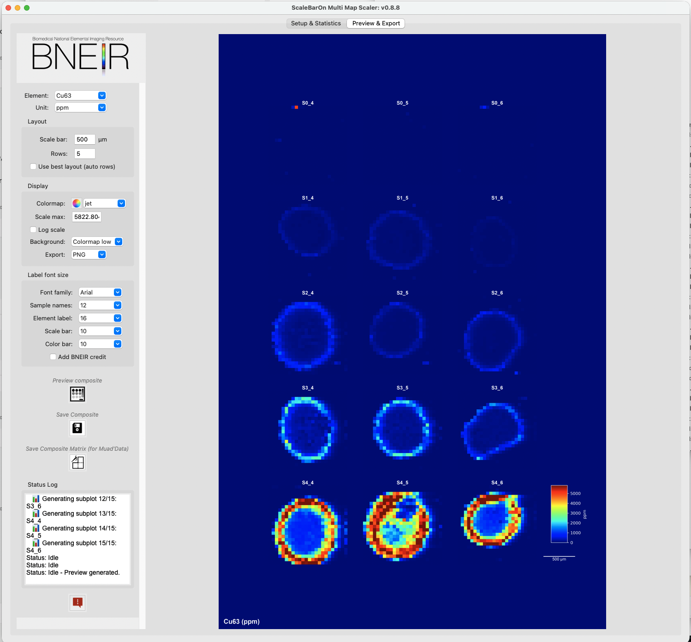

# Outputs

This page describes files ScaleBarOn and Muad'Data write. Exact names depend on the element, unit, and paths you choose.

## ScaleBarOn output folder layout

After **Calculate statistics** and/or saving composites, results are grouped by element and unit under your **Output** folder. Subdirectory names follow the selected element and unit (for example `Fe56_ppm`).

Typical contents for one element–unit combination:

```text
OUTPUT/
  Fe56_ppm/
    Fe56_ppm_statistics.csv
    Histograms/
      SampleA_histogram.png
      ...
    subplots/
      SampleA.png
      ...
    Fe56_ppm_composite.png    # or .tiff, depending on export format
```


| Output                                  | When created                 | Description                                                                           |
| --------------------------------------- | ---------------------------- | ------------------------------------------------------------------------------------- |
| `*_statistics.csv`                      | Calculate statistics / batch | Per-sample 25th, 50th, 75th, 99th percentiles, IQR, mean (and alias column when used) |
| `Histograms/*_histogram.png`            | Statistics for new samples   | Histogram of pixel values (x-axis up to the sample 99th percentile)                   |
| `subplots/*.png`                        | Composite generation         | Individual panel images                                                               |
| `*_composite.png` or `*_composite.tiff` | Save Composite / batch       | Multi-panel figure with color bar and scale bar                                       |
| `*_composite_matrix.xlsx` or `.csv`     | Save Composite Matrix        | Grid of matrices with NaN padding/separators for Muad'Data (optional save dialog)     |
| `sample_aliases.csv`                    | When aliases are edited      | Sample ID → display alias for the current output directory                            |


### Export options that affect the composite image

- **Export:** PNG or TIFF (TIFF uses LZW compression when saving via ScaleBarOn’s export helper)
- **Background:** Colormap low, Black, or White
- **Add BNEIR credit:** optional text overlay on exports
- Element label and other fonts: controlled on Preview & Export

Default export resolution for saved composites is **300 dpi** in the image-save helper.

## Muad'Data exports

Muad'Data asks for a path when you save. Common export types include:


| Feature                           | Typical formats                                          |
| --------------------------------- | -------------------------------------------------------- |
| Viewed map / figure               | PNG or TIFF                                              |
| Cropped or math-result matrix     | `.xlsx` or `.csv`                                        |
| LOD-filtered matrix               | `.xlsx` or `.csv` (plus a metadata sidecar when written) |
| Background ROI                    | `.json`                                                  |
| Polygon / region statistics table | `.csv`                                                   |
| Z-stack summed matrix             | `.xlsx` or `.csv`                                        |
| RGB-related matrices / images     | `.xlsx` / `.csv` / PNG or TIFF depending on the action   |


Exact default filenames vary by tool; the save dialog always lets you choose the location.

## Example outputs in the repository

- `[JAAS submission/Output examples/](../JAAS%20submission/Output%20examples/)` — example composites from the JAAS-related materials
- Root-level sample images may also appear in the clone (for example composite PNGs); treat the JAAS folder and your own **Output** directory as the primary references



## Related links

- [Scaling methods](scaling-methods.md)
- [Quick start](quick-start.md)
- Back to [README](../README.md)
- Visit the BNEIR website for a video tutorials on all BNEIR free software: [https://sites.dartmouth.edu/bneir/user-resources/software/](https://sites.dartmouth.edu/bneir/user-resources/software/)


